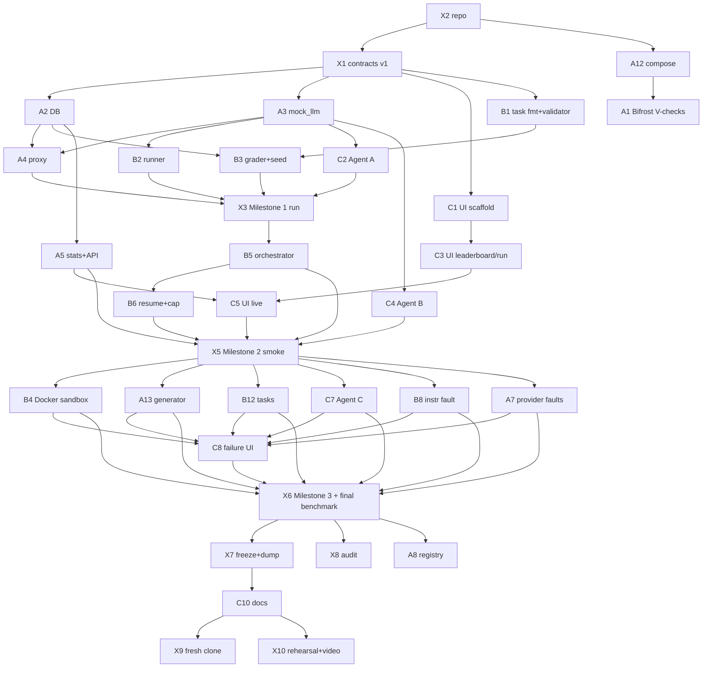

# HACKATHON_PLAN · AgentArena

Operating plan for the team. Milestones/focus: [PROJECT_ROADMAP.md](PROJECT_ROADMAP.md) · tasks: [docs/14-task-board.md](docs/14-task-board.md) · decisions: [docs/01](docs/01-hackathon-strategy.md) · doc map: [docs/README.md](docs/README.md).

Last updated 2026-11-12. Deadline 2026-11-15. **Current Focus: M0 — contracts sign-off (X1), repo (X2), then parallel start of A1/A2/A3/B1/C1.**

## 0. Teammates: start here (15 minutes)
1. Clone: `git clone https://github.com/yokshith09/AgentArena.git` (needs collaborator access, OQ-09).
2. Read in order: this file → [PROJECT_ROADMAP.md](PROJECT_ROADMAP.md) §1–3 → your role's docs ([docs/README.md](docs/README.md)) → your tasks in [docs/14-task-board.md](docs/14-task-board.md).
3. **Answer the open questions** in [docs/15-open-questions.md](docs/15-open-questions.md): fill the *Answer / Date / By* cells you know (blocking first: OQ-05, OQ-08, OQ-09, OQ-12, OQ-13). Unanswered ones fall back to their stated default.
4. **Acknowledge the contracts (X1):** read [07](docs/07-data-schema.md), [08](docs/08-api-contracts.md), [10](docs/10-integration-contracts.md); add your name to the changelog in doc 10, or open a `contract/X1-...` PR with objections.
5. Tell the team which role you take (OQ-04) and your hours for 12–15 Nov.
Commit docs changes on a branch `docs/<topic>` and open a PR, or commit straight to `main` for answer cells only.

## 1. What we are building
Agent → our proxy → Bifrost → LLM. Runner sandboxes the agent, grader decides success, Postgres stores runs/events, dashboard shows leaderboard, comparison, run traces, failure behaviour. Scope decision D-12: full plan, cut by the plan's cut line. Rubric unknown (OQ-01). Tavily is required (D-13). No guarantee of completion is made; load is high (see board).

## 2. Team allocation
Three developers, assigned by component boundary so each can integrate independently (skills not used, per instruction; availability unknown, A-03). One accountable owner per task.

| Dev | Boundary | Main tasks | P0 planned h* |
|---|---|---|---|
| Dev-A | Platform: repo, compose, Bifrost, DB, `mock_llm`, proxy, stats/API, provider faults, mutation generator | X2, X1, A12, A1, A2, A3, A4, A5, A6, A7, A13, X5, X7, X9 | 42.5 |
| Dev-B | Execution: task format/validator, grader, runner, Docker sandbox, orchestrator, instruction fault, tasks, registry | B1, B2, B3, B5, B6, B12, B4, B8, X3, X6, (A8 P1) | 42.0 (+8) |
| Dev-C | Experience: dashboard + mocks, agents A/B/C, tool-fault hook, docs/demo | C1–C5, C7, C8, C10, X4, X8, X10, X11, (C9 P1) | 42.5 (+2) |

\*Midpoint estimates (board). Names → roles: A=__, B=__, C=__ (OQ-04). Reviewer ring: A→B→C→A; fallbacks: [docs/11](docs/11-team-execution-plan.md) §3.

## 3. Dependency graph (what must finish first)

**Parallel from the start (after X1):** A2, A3, C1, B1, A12→A1. **Must finish first:** X2, X1. Contracts and mocks exist (docs 07/08/10, `mock_llm`, UI fixtures) before any dependent task begins; no task depends on an interface that is not in version 1.
Critical path: X2 → X1 → A2/A3 → A4 → X3 → B5 → X5 → X6 → X7 → C10 → X10.

## 4. SDLC, branching, PR and integration cadence

Lifecycle used (generic SDLC; no specific framework document was supplied): **Plan** (contracts, board) → **Build** (task branch) → **Verify** (task tests + contract checks) → **Integrate** (merge to `main`, milestone integration task) → **Release** (CP gate, demo data freeze). The loop repeats per milestone.

| Topic | Rule |
|---|---|
| Branch names | `feat/<ID>-slug`, `fix/<ID>-slug`, `contract/<ID>-slug`, `docs/<ID>-slug`, `chore/<ID>-slug` (e.g. `feat/A4-proxy-streaming`). One task = one branch where possible. |
| Base | `main` is always runnable (compose starts, mocks work). No direct pushes after X2. |
| PR | Title `[ID] summary`; body: task ID, acceptance criteria checked, tests run + result, contract impact (none/additive/breaking). Keep PRs ≤ ~1 day of work; merge at least every ~3 h of work. Squash merge. |
| Review | Reviewer per ring ([docs/11](docs/11-team-execution-plan.md) §3). `contract` PRs need both other devs ([docs/10](docs/10-integration-contracts.md) §6). If the reviewer is blocked > 1 h, self-merge with passing checks and log it in the PR. |
| Merge checks | (1) owner's tests for the task pass; (2) T-16/T-30 fixture consistency still pass once they exist; (3) no secrets (`.env` ignored, scan); (4) docs/fixtures updated if a contract changed; (5) task status updated on the board. Automated CI is not assumed; checks run locally and are listed in the PR. |
| Definition of Done (every task) | Acceptance criteria met; listed tests pass and result recorded in [docs/09](docs/09-testing-and-demo.md); merged to `main`; board status = Done; mock/fixture updated if the output shape is consumed by someone else. |
| Integration cadence | Daily start sync (15 min): board + blockers. Merge-to-main frequently. Each milestone ends with an integration task on the real compose stack (X3, X5, X6). Last hour of each day = integration/fix slot. CP gates: [PROJECT_ROADMAP.md](PROJECT_ROADMAP.md) §3. |
| Decisions | Go into [docs/01](docs/01-hackathon-strategy.md) (D/P/A/OQ), never only chat. |

## 5. Timeboxes (re-baselined 2026-11-12)

| Window | Gate | Active milestone |
|---|---|---|
| 12 Nov AM | CP0 midday | M0 |
| 12 Nov midday → EOD | CP1 | M1 |
| 13 Nov AM | CP2 midday | M2 |
| 13 Nov midday → EOD | CP3 (final benchmark launched) | M3 |
| 14 Nov AM | CP4 midday, feature freeze | M4 |
| 14 Nov midday → EOD | CP5 submit-ready | M5 |
| 15 Nov | Buffer; submission | — |

CP0 was previously 11 Nov EOD; it is now folded into 12 Nov AM because nothing was started — the first slip, already absorbed from M1 time. Further slips trigger cut rules at the next gate, not silent window moves.

## 6. Risk and fallback plan

| Risk | Early signal | Fallback |
|---|---|---|
| Bifrost differs from assumption (A-01/A-02) or key not available | V-01/V-02 fail at CP0 | Proxy forwards directly to the provider (record as deviation on Limitations); all others continue on `mock_llm` |
| Provider rate limits / cost overrun | Spend > 50% before final run | Parallelism 1-2, cheaper model, smaller fault subset; final data dump `db/demo-data.sql` so demo never needs live calls |
| Provider outage on demo day | Health check before demo | Restore dump; live-launch demo uses labelled `mock_llm` mode |
| Docker unavailable / sandbox late (OQ-08, B4) | Not confirmed at CP0; B4 > 0.5 day late | Subprocess runner stays; state on Limitations; hardening is cut rule 7 |
| Framework agent B won't take a base URL (R-3) | C4 not working by CP1 + 0.5 d | Choose another framework; last resort relabelled second plain variant (disclosed) |
| Tool faults only work on reference agents (R-6) | — | Documented limit |
| Contract drift | T-16/T-30 fail | Block merge; §4 contract protocol |
| Overload on one dev (B M2/M3 peak) | Task > 25% late | Fallback owners ([docs/11](docs/11-team-execution-plan.md) §3); A has slack in M4, C in M1 start |
| Windows/Linux differences (A-06) | Test fails on one OS | Fix in runner; containers as reference |
| Flaky results | Wide intervals | Show them; do not hide (design intent) |

## 7. Scope-cut rules
Authoritative: [docs/12](docs/12-delivery-plan.md) §4 (cut order 14 → 13 → 12 extras → 11 → Stage 9 → Stage 8 extras → Docker hardening → benchmark size). Trigger = a gate missed by > half a day or a task > 25% over estimate with no relief. Never cut: Stages 0–7, ≥ 4 faults with resilience score, Stage 15, interval/n/INFRA visibility, MOCK ribbon, three reference agents.

## 8. Demo-critical path
V-01 → proxy events (T-01) → runner + grader (T-07/T-08) → X3 → orchestrator (T-13) → stats/API (T-15/T-16) → live leaderboard + trace (T-18) → faults + resilience (T-20/T-21) → X6 final benchmark → X7 freeze → C10 docs → X10 rehearsal. Everything else is optional for the demo.

## 9. Presentation
Out of scope. [docs/PPT_FRAMEWORK.md](docs/PPT_FRAMEWORK.md) remains an untouched placeholder.

## 10. Status log
| Date | Gate | Note |
|---|---|---|
| 2026-11-11 | — | Documentation pack drafted; nothing implemented |
| 2026-11-12 | pre-CP0 | Roadmap, board, SDLC rules added; repo not created; X1 sign-off pending |
