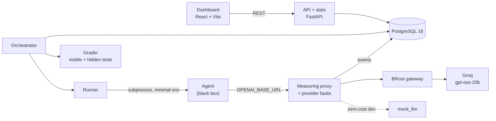
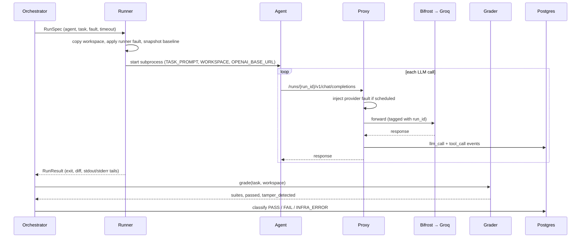
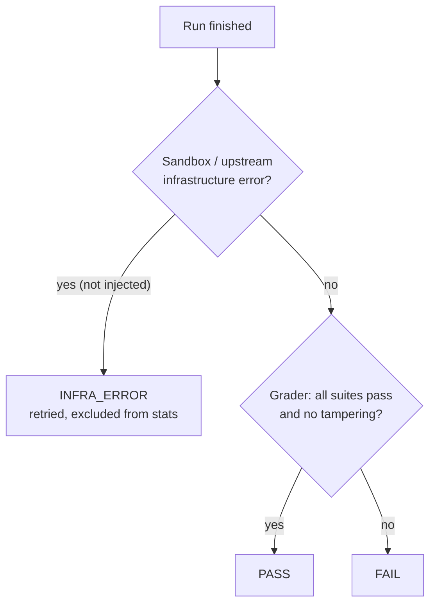

<div align="center">

# AgentArena

**Benchmark AI agents, not just models: success, cost, steps, reliability and the full trace of every run.**


Global AI Hackathon · Problem Statement 02 · Bifrost by Maxim AI

[Overview](#overview) · [Features](#key-features) · [Architecture](#system-architecture) · [Quickstart](#installation--setup) · [Results](#results--benchmarks) · [Limitations](#limitations--future-scope)

</div>

---

## Overview

### The problem
Leaderboards score **models**, but products ship **agents**: a model plus prompts, tools, retry logic and
limits. Two agents on the same model can differ widely in success, cost and reliability, yet comparisons
are usually anecdotes: one run, one prompt, no cost, no trace, and no idea how the agent behaves when
something breaks.

### The solution
AgentArena runs any agent as a **black box** on identical coding tasks and measures it from the outside:

1. Every LLM call goes through a **measuring proxy** and the **Bifrost** gateway, so tokens, cost, latency
   and tool calls are recorded without changing the agent.
2. Results are graded with visible **and hidden** tests, with tamper detection.
3. Runs are repeated and reported with **confidence intervals**, not single numbers.
4. Controlled **faults** (outage, rate limit, broken tool, misleading instruction) show how agents behave
   when things go wrong.
5. A dashboard shows the leaderboard, side-by-side comparison, failure scenarios and the step-by-step
   timeline of every run.

---

## Key Features

| Feature | What it does | Status |
|---|---|---|
| Black-box agent runner | Runs any program that honours `OPENAI_BASE_URL` in a temp workspace, with a minimal env (no provider keys), timeout and process-tree kill | ✅ Implemented |
| Measuring proxy | Records every `llm_call` and `tool_call` with tokens, cost, latency; streaming supported; unknown cost stored as `null`, not 0 | ✅ Implemented |
| Bifrost gateway | Single route to the provider; the provider key lives only in the Bifrost container | ✅ Implemented |
| Tamper-resistant grader | Grades a clean copy; restores protected tests; runs hidden tests; flags edited/deleted tests and planted `conftest.py` | ✅ Implemented |
| Task validator | Accepts a task only if the broken state fails, the reference passes and grading is deterministic | ✅ Implemented |
| Fault injection | Provider 503 and 429 (proxy), `run_tests` tool errors (agent env), misleading instruction (runner) | ✅ Implemented |
| Orchestrator | Agents × tasks × scenarios × repeats; PASS / FAIL / INFRA_ERROR classification; retries infra errors; spend cap; resume after crash | ✅ Implemented |
| Statistics | Wilson 95% intervals for pass rate; mean/median/std and fixed-seed bootstrap intervals for cost, steps, tool calls, time; resilience score | ✅ Implemented |
| REST API | FastAPI with OpenAPI docs at `/docs` | ✅ Implemented |
| Dashboard | Leaderboard, Benchmarks + launcher, Compare, Failure scenarios, Catalog, run timeline, Limitations; mock and live modes; Ctrl/⌘K quick actions | ✅ Implemented |
| Docker-sandboxed agents with network blocking | Container isolation instead of subprocess | 🗓 Planned (cut for the hackathon) |
| Agent registry + `doctor` command, security/injection tasks, model-override matrix, multi-agent, replay, Tavily research agent | See [docs/03](docs/03-feature-specs.md) | 🗓 Planned |

---

## System Architecture

### Components



### Lifecycle of one run



### Outcome classification



Injected faults never count as infrastructure errors, so an agent that fails under an outage is charged with that failure.

---

## Technology Stack

| Layer | Technology |
|---|---|
| Language | Python 3.12+, TypeScript |
| API & proxy | FastAPI 0.162, Uvicorn, httpx |
| Database | PostgreSQL 16, psycopg 3, SQL migrations (`db/migrations`) |
| LLM gateway | Bifrost (Maxim AI) |
| Model provider | Groq `openai/gpt-oss-20b` |
| Reference agents | Framework-free loop (A, C), OpenAI Agents SDK 0.24 (B) |
| Frontend | React 19, Vite 8, TypeScript, Vitest |
| Contracts | JSON Schema (`contracts/`) via `jsonschema` |
| Infrastructure | Docker Compose |
| Quality | pytest, Hypothesis, Ruff |

---

## Project Directory Structure

```text
AgentArena/
├── agents/            # Reference agents: agent_a (plain), agent_b (OpenAI Agents SDK), agent_c (retry), common tools, dummy
├── api/               # FastAPI REST API + stats (Wilson, bootstrap, resilience)
├── bifrost/           # Bifrost gateway config (provider key read from env)
├── contracts/         # JSON Schemas: agent, task, run, event (+ examples)
├── db/                # Migrations, migrate script, fixtures, frozen demo data (demo-data.sql, demo.py)
├── docs/              # PRD, specs, architecture, schema, API contracts, testing, plans (01–16)
├── faults/            # Fault definitions (YAML): 503, 429, tool error, misleading hint
├── frontend/          # React + Vite dashboard
├── grader/            # grade.py (grading + tamper detection), validate.py (task validator)
├── mock_llm/          # Scripted OpenAI-compatible server for zero-cost testing
├── orchestrator/      # Scheduling, classification, resume, spend cap; seed.py indexes agents and tasks
├── proxy/             # Measuring proxy: events, pricing, provider faults
├── runner/            # run.py: black-box subprocess runner
├── scripts/           # Contract check, Bifrost smoke test
├── tasks/             # 5 Python repair tasks (workspace, hidden_tests, reference_solution, grader.yaml)
├── tests/             # pytest suites per component
├── docker-compose.yml # postgres, migrate, api, proxy, bifrost, mock_llm (profile: mock)
└── pricing.yaml       # Versioned token prices
```

---

## Installation & Setup

### Prerequisites
**Docker Desktop**, **Python 3.12+**, **Node.js 22.12+**, Git.

### 1. See the real results (no API keys needed)

```bash
git clone https://github.com/yokshith09/AgentArena.git
cd AgentArena
cp .env.example .env                  # PowerShell: Copy-Item .env.example .env
```

> If port 5432 is already in use, set `POSTGRES_PORT=5433` **and** the same port in `DATABASE_URL` in `.env`.

```bash
docker compose up -d --build migrate api        # Postgres + schema + REST API on :8000
pip install -r requirements.txt                 # host tools (psycopg etc.)
```

Set `DATABASE_URL` from `.env` in each new terminal:

```powershell
$env:DATABASE_URL = (Select-String -Path .env -Pattern '^DATABASE_URL=').Line.Split('=', 2)[1]
```
```bash
export $(grep '^DATABASE_URL=' .env)
```

Load the frozen benchmark data (real runs on Groq `gpt-oss-20b` via Bifrost, 15 Nov 2026):

```bash
python db/demo.py load
```

Start the dashboard:

```bash
cd frontend
npm install
npm run dev
```

Open **http://localhost:5173/?mode=live**. API docs: **http://localhost:8000/docs**.
Without `?mode=live` the dashboard shows illustrative mock fixtures, labelled **MOCK DATA**.

Stop with `docker compose down` (keeps the data volume; add `-v` to delete it).

### 2. Run your own benchmark (needs a Groq API key)

1. Put the key in `.env` as `GROQ_API_KEY=...`. It is passed **only** to the Bifrost container. Keep
   `UPSTREAM_BASE_URL=http://bifrost:8080/v1`.
2. Start the measuring path:
   ```bash
   docker compose up -d --build migrate api proxy bifrost
   ```
   Check: `curl http://localhost:8080/v1/models` lists Groq models.
3. Install agent dependencies in a virtual environment (the runner starts agents with the same Python):
   ```bash
   python -m venv .venv
   .venv/Scripts/activate                 # macOS/Linux: source .venv/bin/activate
   pip install -r requirements-dev.txt -r agents/requirements.txt
   ```
4. Index agents and tasks (tasks load only if the validator accepts them):
   ```bash
   python -m orchestrator.seed
   ```
5. Launch a benchmark from the dashboard (**Benchmarks → New benchmark**) or `POST /api/benchmarks`.
6. Run the orchestrator. The Groq free tier allows about 8K tokens/min, so space runs ~35 s:
   ```bash
   python -m orchestrator --once --parallel 1 --min-interval 35
   ```

**Zero-cost alternative:** set `UPSTREAM_BASE_URL=http://mock_llm:9000/v1` and run
`docker compose --profile mock up -d mock_llm proxy`. Replies are scripted, so agents cannot actually solve
tasks; this tests the pipeline only.

---

## Usage

### Dashboard

| Page | Use it to |
|---|---|
| **Catalog** | Browse agents, tasks and fault scenarios |
| **Benchmarks** | List benchmarks; **New benchmark** launches one with agents, tasks, scenarios, repeats and a spend cap |
| **Leaderboard** | Pass rate with 95% interval, cost, steps, tool calls, time, INFRA exclusions |
| **Compare** | Per-task grid; shows "no clear difference" when intervals overlap |
| **Failure scenarios** | Baseline vs fault pass rate and resilience score |
| **Run detail** | Timeline of LLM and tool calls, faults, diff, grader result, environment |
| **Limitations** | What the results do and do not show |

Press **Ctrl+K** (⌘K on macOS) for quick actions: jump to a page, switch live/mock mode, start a new benchmark or open a benchmark.

### Orchestrator CLI

| Flag | Default | Meaning |
|---|---|---|
| `--once` | off | Process queued benchmarks, then exit |
| `--parallel N` | `ORCH_PARALLEL` or 2 | Concurrent runs |
| `--min-interval S` | `ORCH_MIN_INTERVAL_S` or 0 | Minimum seconds between run starts |
| `--timeout S` | `RUN_TIMEOUT_S` or 300 | Per-run wall-clock limit |
| `--proxy URL` | `PROXY_BASE_URL` or `http://localhost:8001` | Proxy the agents call |
| `--stub` | off | Stand-in runner and grader, for pipeline tests |

### REST API

| Method | Endpoint |
|---|---|
| GET | `/api/health` |
| GET | `/api/agents`, `/api/agents/{agent_id}` |
| GET | `/api/tasks`, `/api/scenarios` |
| GET / POST | `/api/benchmarks` (POST returns 202 and queues the benchmark) |
| GET | `/api/benchmarks/{id}`, `/api/benchmarks/{id}/results`, `/api/benchmarks/{id}/resilience` |
| GET | `/api/runs`, `/api/runs/{run_id}`, `/api/runs/{run_id}/events` |

Full schemas: http://localhost:8000/docs and [docs/08](docs/08-api-contracts.md).

### Add your own agent
Create `agents/<name>/agent.yaml` (`name`, `mode: command`, `entrypoint`, `model_config.model`,
`description`) and make the program read `TASK_PROMPT`, `WORKSPACE` and `OPENAI_BASE_URL`. Run
`python -m orchestrator.seed`, then select it in a new benchmark. Environment contract:
[docs/10 §2.2](docs/10-integration-contracts.md).

### Run the tests

```bash
pytest                       # Python suites (some need DATABASE_URL pointing at Postgres)
cd frontend && npm test      # Vitest dashboard tests
```

---

## Implementation Details

**Reference agents**

| Agent | Built with | LLM retry |
|---|---|---|
| A | Framework-free tool loop | None (baseline) |
| B | OpenAI Agents SDK | SDK behaviour |
| C | Agent A + code-level retry | 3 retries on 429 / 5xx / timeouts, honouring `Retry-After` |

All three share the tools `list_files`, `read_file`, `write_file`, `run_tests` and use temperature 0 by default (`ARENA_TEMPERATURE`).

**Tasks:** five hand-written Python repair tasks: `fix-off-by-one`, `add-slugify`, `fix-average-empty`,
`fix-palindrome`, `fix-mutable-default`. Each has `task.yaml`, `prompt.md`, `workspace/`, `hidden_tests/`,
`grader.yaml` and `reference_solution/`.

**Faults**

| ID | Layer | Effect |
|---|---|---|
| `provider_503_outage` | Proxy | First N calls return 503 |
| `provider_429_ratelimit` | Proxy | First N calls return 429 |
| `tool_run_tests_error` | Agent env | `run_tests` fails for the first calls |
| `instruction_misleading_hint` | Runner | Prepends a misleading maintainer note to `solution.py` |

**Grading safeguards:** clean-copy grading, protected files restored, planted `conftest.py` detected, JUnit
XML parsed with DOCTYPE/ENTITY rejected, zero collected tests treated as failure, and
`PYTEST_DISABLE_PLUGIN_AUTOLOAD=1` (which also cut grading time from 19.4 s to 5.4 s).

**Data model:** `agents`, `tasks`, `benchmarks`, `runs`, `events` (see [docs/07](docs/07-data-schema.md)).
Pricing is versioned in `pricing.yaml`; unknown prices are stored as `null`.

---

## Results & Benchmarks

Frozen in `db/demo-data.sql`: **4 benchmarks, 33 real runs, 421 events, 3 agents, 5 tasks** on Groq
`gpt-oss-20b` via Bifrost (15 Nov 2026).

**X6 final: baseline (3 agents × 5 tasks, 1 run each)**

| Agent | Passed | Note |
|---|---|---|
| B (OpenAI Agents SDK) | **5 / 5** | |
| A (plain) | 4 / 5 | Missed a hidden test on `fix-off-by-one` |
| C (retry) | 4 / 5 | Missed a hidden test on `fix-off-by-one` |

**Under faults (one task, one run per cell):** Agent A failed under the 503, 429 and tool faults. Agent C
was the only agent to survive the 429 rate limit.

- **0** infrastructure errors in X6; total cost about **$0.011**.
- Proxy token counts matched Bifrost's own logs exactly.
- Measured proxy overhead: median **+17.3 ms** per call (40 calls against `mock_llm`).

> ⚠️ With one run per cell, confidence intervals are wide. These results show the method, not
> conclusive rankings. The fault results are illustrative.

---

## Screenshots & Demonstrations

The repository does not include screenshots yet. To see each view yourself after the quickstart:

| View | URL |
|---|---|
| Leaderboard | http://localhost:5173/?mode=live (choose *X6 final: baseline*) |
| Failure scenarios | http://localhost:5173/resilience?mode=live (choose *X6 final: faults*) |
| Compare | http://localhost:5173/compare?mode=live |
| Run timeline | Click an agent, then a run |
| Mock fixtures (no backend needed) | http://localhost:5173/ |

<!-- Add screenshots to docs/evidence/ and link them here, e.g.  -->

---

## Limitations & Future Scope

### Current limitations
- One run per agent × task in the demo data (Groq free tier: 200K tokens/day), so intervals are wide.
- One model (Groq `gpt-oss-20b`), five hand-written Python tasks, and faults measured on one task.
- Cost uses list prices. Groq's cached-input discount is not modelled (Bifrost's figure was 8.5% lower on X6).
- Agents run as subprocesses with a minimal environment, not in a hardened container.
- Tool faults reach only agents that use the shared tools module. Provider and instruction faults apply to any agent.

### Future scope (planned, not implemented)
- Docker sandbox with network blocking for agents.
- Agent registry with a `doctor` command.
- Security and prompt-injection tasks.
- Model-override matrix to separate the agent effect from the model effect.
- Multi-agent cost attribution, offline replay, and mutation-generated tasks.
- A Tavily-powered research agent and tasks.

---

## How AI Is Used
- **In the product:** the benchmarked agents are LLM-driven (Groq `gpt-oss-20b`, reached only through
  Bifrost); AgentArena measures them.
- **AI tools used to build it:** _to be completed by the team before submission._

## Documentation
- Start here: [HACKATHON_PLAN.md](HACKATHON_PLAN.md) · [Final-day plan](docs/16-final-day-plan.md) · [Task board](docs/14-task-board.md) · [Docs index](docs/README.md)
- Components: [proxy](proxy/README.md) · [api](api/README.md) · [orchestrator](orchestrator/README.md) · [db](db/README.md) · [frontend](frontend/README.md)
- Specs: [PRD](docs/02-prd.md) · [Feature specs](docs/03-feature-specs.md) · [Architecture](docs/04-trd-architecture.md) · [Data schema](docs/07-data-schema.md) · [API contracts](docs/08-api-contracts.md) · [Integration contracts](docs/10-integration-contracts.md) · [Testing & demo](docs/09-testing-and-demo.md)
