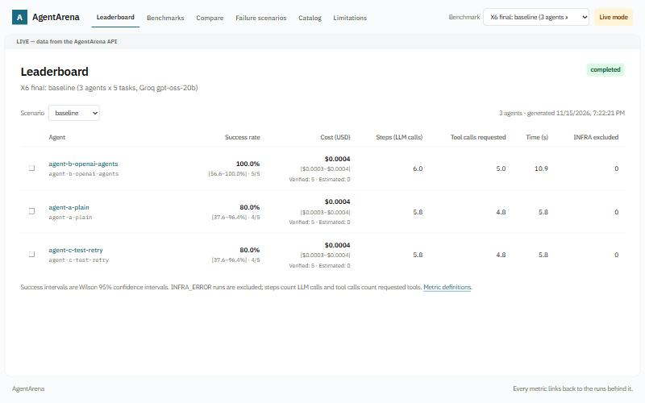
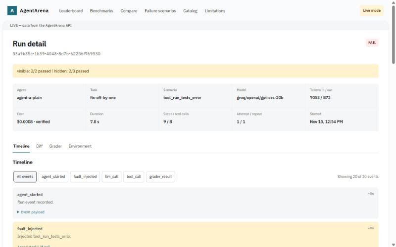
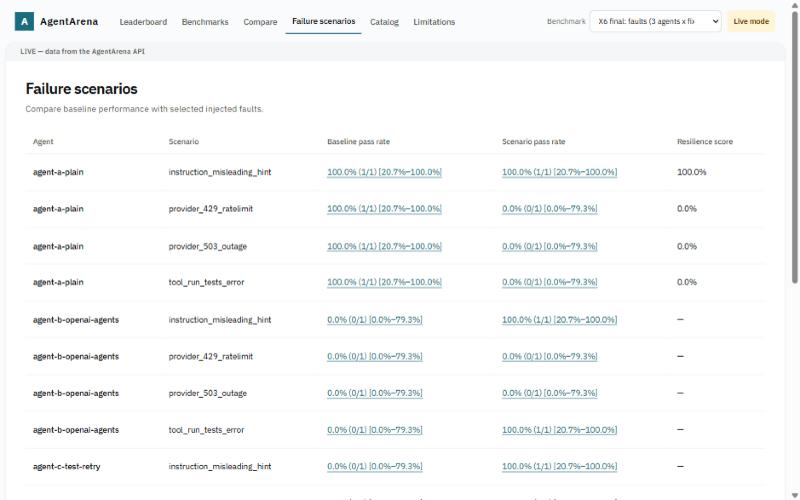
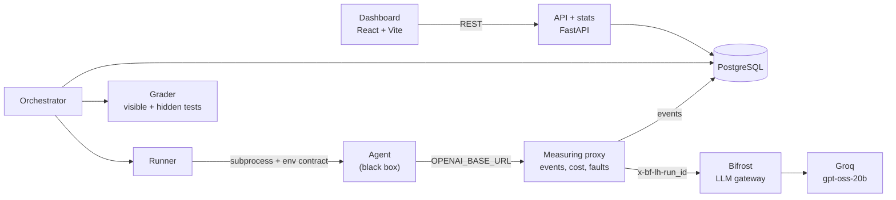

<div align="center">

# AgentArena

**Benchmark AI agents like software, not anecdotes.**

Run any agent as a black box on identical tasks, measure every LLM call through
[Bifrost](https://github.com/maximhq/bifrost), grade with hidden tests, inject failures, and compare
with confidence intervals and full traces.


*Global AI Hackathon · Problem Statement 02 · Bifrost by Maxim AI*



</div>

---

## Contents

- [Why AgentArena](#why-agentarena)
- [Features](#features)
- [Results](#results)
- [Quickstart](#quickstart)
- [Run your own benchmark](#run-your-own-benchmark)
- [Architecture](#architecture)
- [How Bifrost is used](#how-bifrost-is-used)
- [Methodology](#methodology)
- [Project structure](#project-structure)
- [Add your agent](#add-your-agent)
- [Testing](#testing)
- [Limitations](#limitations)
- [Tech stack](#tech-stack)
- [How AI is used](#how-ai-is-used)
- [Documentation](#documentation)
- [Team](#team)

## Why AgentArena

Agent comparisons are usually one run, one prompt, no cost, no trace, and no idea what happens when
something breaks. AgentArena treats agents as black boxes and measures them the same way every
time:

- **Identical conditions.** Every agent gets the same task workspace, the same model, the same
  timeout, and talks to the model only through our measuring proxy and Bifrost.
- **Honest grading.** A clean copy of the workspace is graded with visible *and hidden* tests;
  tampering with protected files fails the run.
- **Real numbers.** Success with 95% confidence intervals, plus cost, steps, tool calls and time
  measured from the actual LLM traffic, cross-checked against Bifrost's own logs.
- **Behaviour under failure.** Controlled provider outages, rate limits, broken tools and misleading
  instructions, with a resilience score per agent.
- **Every number is traceable.** Each metric links to the runs behind it and each run to its
  step-by-step timeline, diff and grader output.

## Features

| | |
|---|---|
| **Black-box agents** | Any program that honours `OPENAI_BASE_URL` (three reference agents included: framework-free, OpenAI Agents SDK, test-retry) |
| **Measuring proxy** | Records every `llm_call` and `tool_call` with tokens, cost, latency; streaming and non-streaming |
| **Bifrost gateway** | Single route to the model provider; provider key never reaches agents |
| **Orchestrator** | agents × tasks × scenarios × repeats, bounded parallelism, INFRA retry (≤3), spend cap, crash recovery |
| **Grader** | Clean-copy grading, visible + hidden pytest suites, tamper detection |
| **Fault injection** | Provider 503 outage, 429 rate limit, broken `run_tests` tool, misleading instruction |
| **Statistics** | Wilson intervals, bootstrap intervals (fixed seed), INFRA errors excluded, resilience score |
| **Dashboard** | Leaderboard, compare grid, failure scenarios, catalog, run timeline, diff, grader and environment tabs |
| **Reproducibility** | Task and agent hashes, pricing version and model in every run's fingerprint; frozen demo data |

## Results

Real runs on Groq `openai/gpt-oss-20b` through Bifrost, 15 Nov 2026 (frozen in
[`db/demo-data.sql`](db/demo-data.sql)).

**Baseline, 3 agents × 5 tasks**

| Agent | Pass rate (95% CI) | Mean cost | Steps | Tool calls | Time |
|---|---|---|---|---|---|
| Agent B · OpenAI Agents SDK | **5/5 = 100%** (57–100%) | $0.00036 | 6.0 | 5.0 | 10.9 s |
| Agent A · framework-free | 4/5 = 80% (38–96%) | $0.00035 | 5.8 | 4.8 | 5.8 s |
| Agent C · test-retry | 4/5 = 80% (38–96%) | $0.00037 | 5.8 | 4.8 | 5.8 s |

Agents A and C both fix `fix-off-by-one`'s visible tests but fail a hidden test.

**Under faults** (`fix-off-by-one`): Agent A passes its baseline but fails under the 503 outage,
the 429 rate limit and the broken test tool, and shrugs off the misleading instruction. Agent C is
the only agent that survives the 429 rate limit, which is what its retry design is for.

**Accuracy:** 30 runs, 0 infrastructure errors, **$0.011** total. Token counts match Bifrost's logs
exactly; an audit of 5 random runs found steps, tool calls and tokens identical across the run
record, the event trace and Bifrost ([X8 audit](docs/evidence/x8-accuracy-audit.md)).

<p align="center">
  
  
</p>

## Quickstart

See the real results locally. **No API keys needed.**

**Prerequisites:** Docker Desktop, Python 3.12+, Node.js 22.12+, Git.

```bash
git clone https://github.com/yokshith09/AgentArena.git
cd AgentArena
cp .env.example .env                  # PowerShell: Copy-Item .env.example .env
```

> If port 5432 is already in use (e.g. a local PostgreSQL), set `POSTGRES_PORT=5433` **and** the
> same port in `DATABASE_URL` in `.env`.

**1. Start the database and API**

```bash
docker compose up -d --build migrate api        # Postgres + schema + REST API on :8000
pip install -r requirements.txt                 # host tools
```

**2. Load the frozen benchmark data.** Host scripts read `DATABASE_URL`; take it from `.env` in each
new terminal:

```powershell
$env:DATABASE_URL = (Select-String -Path .env -Pattern '^DATABASE_URL=').Line.Split('=', 2)[1]
```
```bash
export $(grep '^DATABASE_URL=' .env)
```
```bash
python db/demo.py load
```

**3. Start the dashboard**

```bash
cd frontend
npm install
npm run dev
```

Open **http://localhost:5173/?mode=live** and pick a benchmark at the top right: *X6 final:
baseline* for the leaderboard, *X6 final: faults* for **Failure scenarios**. Click an agent, then a
run, for its timeline, diff, grader result and environment. API docs: http://localhost:8000/docs.
Without `?mode=live` the dashboard shows illustrative fixtures labelled MOCK DATA.

Stop with `docker compose down` (keeps the data; add `-v` to delete it).

## Run your own benchmark

Requires a [Groq](https://console.groq.com) API key (the free tier is enough for small runs).

1. Add the key to `.env` as `GROQ_API_KEY=...`. It is passed **only** to the Bifrost container
   ([`bifrost/config.json`](bifrost/config.json) references it as `env.GROQ_API_KEY`). Keep
   `UPSTREAM_BASE_URL=http://bifrost:8080/v1`.
2. Start the measuring path:
   ```bash
   docker compose up -d --build migrate api proxy bifrost
   curl http://localhost:8080/v1/models          # lists Groq models via Bifrost
   ```
3. Install agent dependencies in a virtual environment (the runner starts agents with the same Python):
   ```bash
   python -m venv .venv
   .venv/Scripts/activate                       # macOS/Linux: source .venv/bin/activate
   pip install -r requirements-dev.txt -r agents/requirements.txt
   ```
   (`requirements-dev.txt` adds pytest, which the grader and task validator run.)
4. With `DATABASE_URL` set as above, index agents and tasks (tasks load only if the validator accepts them):
   ```bash
   python -m orchestrator.seed
   ```
5. Launch a benchmark from the dashboard (**Benchmarks → New benchmark**) or `POST /api/benchmarks`.
6. Run the orchestrator. Groq's free tier allows 8K tokens/min, so space runs about 35 s apart:
   ```bash
   python -m orchestrator --once --parallel 1 --min-interval 35
   ```

Progress and results appear live in the dashboard. For a zero-cost pipeline check, set
`UPSTREAM_BASE_URL=http://mock_llm:9000/v1` and start `docker compose --profile mock up -d mock_llm proxy`
(scripted replies, so agents cannot actually solve tasks).

## Architecture



| Component | Folder | Role |
|---|---|---|
| Measuring proxy | [`proxy/`](proxy/) | Forwards agent traffic to Bifrost, writes `llm_call` / `tool_call` events, prices calls, injects provider faults |
| API + stats | [`api/`](api/) | REST API for the dashboard; all statistics computed server-side |
| Orchestrator | [`orchestrator/`](orchestrator/) | Seeds agents/tasks, schedules runs, classifies outcomes, retries, spend cap |
| Runner | [`runner/`](runner/) | Copies the workspace, applies runner faults, runs the agent with a timeout, diffs the result |
| Grader | [`grader/`](grader/) | Task validator and grader (clean copy, protected files, hidden tests) |
| Agents | [`agents/`](agents/) | Three reference agents and the shared tool module (tool-fault hook) |
| Tasks | [`tasks/`](tasks/) | Five Python bug-fix / feature tasks with visible and hidden tests |
| Database | [`db/`](db/) | Migrations, migration runner, demo data export/load |
| Dashboard | [`frontend/`](frontend/) | Leaderboard, compare, failure scenarios, catalog, run detail |

## How Bifrost is used

- **Single gateway.** Every LLM call from every agent goes agent → measuring proxy → **Bifrost** →
  Groq. The provider key exists only in the Bifrost container; agents get a dummy key.
- **Run tagging.** The proxy adds `x-bf-lh-run_id` to each request, so Bifrost's own logs carry the
  benchmark run id ([`bifrost/config.json`](bifrost/config.json), image pinned by digest).
- **Independent cross-check.** Bifrost's log is a second, independent record of every call. On the
  X6 benchmark, proxy and Bifrost token counts are identical; Bifrost's cost differs only by Groq's
  cached-input discount, which reproduces its figure exactly.

## Methodology

- **Outcome:** PASS if the grader's visible and hidden suites pass on a clean copy with no tampering;
  FAIL on failing tests, tampering or timeout; **INFRA_ERROR** only for infrastructure problems
  (runner/grader failure or a real upstream outage with no recovery). Injected faults never count
  as infrastructure errors. INFRA_ERROR runs are retried (up to 3 attempts) and excluded from stats.
- **Pass rate:** PASS / (PASS + FAIL) with a Wilson 95% interval.
- **Cost, steps, tool calls, time:** mean, median, sample std and a percentile bootstrap 95% interval
  of the mean (1000 resamples, fixed seed). Steps = successful LLM calls; tool calls = tool calls the
  model requested; cost = tokens × versioned [`pricing.yaml`](pricing.yaml).
- **Resilience:** pass rate under a fault ÷ baseline pass rate (undefined when the baseline is 0).
- Full definitions: [data schema §4](docs/07-data-schema.md), [feature specs F-07](docs/03-feature-specs.md).

## Project structure

```
AgentArena/
├── agents/           Reference agents A, B, C + shared tools (tool-fault hook)
├── api/              FastAPI REST API; api/stats = statistics engine
├── bifrost/          Bifrost gateway config (provider key read from env)
├── contracts/        JSON Schemas + examples for run / event / task / agent
├── db/               Migrations, migration runner, demo data (demo.py, demo-data.sql)
├── docs/             Specs, contracts, plans, task board, evidence, screenshots
├── faults/           Fault catalog (provider, tool, instruction)
├── frontend/         React + Vite dashboard
├── grader/           Task validator and grader
├── mock_llm/         Scripted OpenAI-compatible server for zero-cost runs
├── orchestrator/     Benchmark orchestrator and seed loader
├── proxy/            Measuring proxy (events, cost, provider faults)
├── runner/           Subprocess runner (env contract, timeout, diff)
├── scripts/          Contract check, Bifrost smoke test
├── tasks/            Benchmark tasks (workspace, hidden tests, reference solution)
├── tests/            Test suite (proxy, api, stats, db, orchestrator, runner, grader, contracts)
├── docker-compose.yml
├── pricing.yaml      Versioned token prices
└── .env.example      Configuration template (never commit .env)
```

## Add your agent

1. Create `agents/<name>/agent.yaml`:
   ```yaml
   name: my-agent
   mode: command
   entrypoint: python agent.py
   model_config: { model: groq/openai/gpt-oss-20b }
   description: What makes this agent different
   ```
2. Make the program read `TASK_PROMPT` and `WORKSPACE`, call the model at `OPENAI_BASE_URL`, edit
   files only under `WORKSPACE`, and exit 0 when done (full contract:
   [integration contracts §2.2](docs/10-integration-contracts.md)).
3. Run `python -m orchestrator.seed` and select the agent in a new benchmark.

## Testing

```bash
pip install -r requirements-dev.txt -r agents/requirements.txt
docker compose up -d migrate                  # tests that need Postgres create throwaway databases
python -m pytest -q                           # 175 tests
cd frontend && npm test                       # dashboard tests
```

Highlights: proxy contract and fault injection, statistics against hand-computed values, API
responses vs. the documented contract, migration runner, orchestrator classification and crash
recovery, demo data round trip, runner and grader. A fresh-clone walkthrough of this README is
recorded in the [task board](docs/14-task-board.md) (X9).

## Limitations

- One run per agent × task in the demo data (Groq free tier: 200K tokens/day), so intervals are wide.
- One model (`gpt-oss-20b`); five hand-written Python tasks; faults measured on one task.
- Cost uses list prices; Groq's cached-input discount is not modelled (Bifrost's figure was 8.5%
  lower on X6). Per-call cost is stored with 6 decimals (within ±0.4% per run).
- Agents run as subprocesses with a minimal environment, not in a hardened container.
- Tool faults reach only agents that use the shared tools module; provider and instruction faults
  apply to any agent. Results describe behaviour under the chosen conditions, not production failures.

## Tech stack

| Area | Technologies |
|---|---|
| Backend | Python 3.12+, FastAPI, Uvicorn, psycopg 3, PyYAML |
| Data | PostgreSQL 16 |
| LLM path | Bifrost (Maxim AI) gateway → Groq `openai/gpt-oss-20b` |
| Agents | Framework-free Python, OpenAI Agents SDK |
| Frontend | React 19, TypeScript, Vite |
| Infra | Docker Compose |
| Testing | pytest, Vitest |

## How AI is used

- **In the product:** the benchmarked agents are LLM-driven (Groq `gpt-oss-20b`, reached only
  through Bifrost); AgentArena measures and compares them.
- **AI tools used to build it:** Claude Code, Codex

## Documentation

- [Docs index](docs/README.md) · [Final-day plan](docs/16-final-day-plan.md) · [Task board](docs/14-task-board.md) · [Hackathon plan](docs/HACKATHON_PLAN.md) · [Roadmap](docs/PROJECT_ROADMAP.md)
- Specs: [PRD](docs/02-prd.md) · [Feature specs](docs/03-feature-specs.md) · [Architecture](docs/04-trd-architecture.md) · [Data schema](docs/07-data-schema.md) · [API contracts](docs/08-api-contracts.md) · [Integration contracts](docs/10-integration-contracts.md) · [Testing & demo](docs/09-testing-and-demo.md)
- Components: [proxy](proxy/README.md) · [api](api/README.md) · [orchestrator](orchestrator/README.md) · [db](db/README.md) · [frontend](frontend/README.md)
- Evidence: [X8 accuracy audit](docs/evidence/x8-accuracy-audit.md)

## Team

- **Akhil** · platform: measuring proxy, Bifrost integration, database, API and statistics, fault
  injection, orchestrator, benchmark runs, demo data
- **Yokshith** · experience: dashboard, reference agents, tasks, runner and grader
