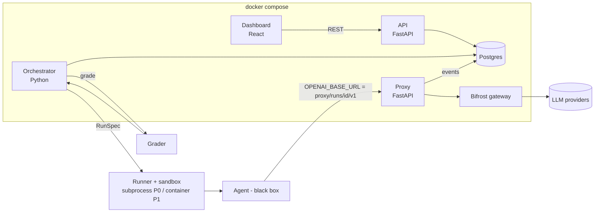

# 04 · Technical Requirements & Architecture (TRD)

> Status: Draft for CP0 sign-off. Data shapes → [07](07-data-schema.md). HTTP shapes → [08](08-api-contracts.md). Component I/O table → [10](10-integration-contracts.md).

## 1. Architecture (from plan §2, D-01)

## 2. Components and boundaries

| Code | Component | Responsibility (owns) | Does NOT do | Owner |
|---|---|---|---|---|
| DB | Postgres + migrations | Persistent state; schema authority | Business logic | A |
| PX | Measuring proxy | Forward, log events, price calls, inject provider faults, (P2) model override/record-replay | Write `runs` rows; classify outcomes | A |
| API | REST API + stats engine | Read models, launch benchmark (insert queued row), stats/resilience computation | Execute runs | A |
| OR | Orchestrator | Expand benchmark → runs, schedule, classify outcome, retry, checkpoint/resume, spend cap, **finalise `runs` rows** | Serve HTTP | B |
| RN | Runner/sandbox | Prepare workspace, env, apply instruction fault, spawn agent, timeout, diff | Grade; touch DB | B |
| GR | Grader + task validator | Tamper-checked grading; validate tasks | Run agents | B |
| TK | Task library | Task folders + `task.yaml`/`grader.yaml` | — | C authors, B format |
| AG | Reference agents | Agents A/B/C (+ P2 team/research) and `agents/common/tools.py` | Measurement | C |
| UI | Dashboard | Render API data; mock mode | Compute statistics (displays server numbers only) | C |
| BF | Bifrost | Routing/provider failover | — (external) | A (setup) |

Rules: **single writer per table** — `agents`/`tasks`: seed loader (B) (+ API register, P1); `benchmarks`: API creates, orchestrator updates `state`; `runs`: orchestrator only; `events`: proxy (and runner/monitor via orchestrator in P1). Statistics are computed server-side only (UI never recomputes) so there is one definition.

## 3. Stack

| Layer | Choice | Basis |
|---|---|---|
| Proxy, API | Python + FastAPI | D-02 |
| Orchestrator, runner, grader, stats | Python | D-02 (pytest/Hypothesis are named in plan) |
| DB | Postgres | D-02 |
| Frontend | React (+ Vite assumed) | D-02, A-07 |
| Packaging | Docker Compose | D-02 |
| Gateway | Bifrost by Maxim AI | Problem statement |
| Config | `.env` (secrets), `pricing.yaml`, `faults/*.yaml`, `agent.yaml`, `task.yaml`, `grader.yaml` | Plan |
| Python | `>=3.12,<3.14` | Initial supported range; pinned packages are in `requirements.txt` and `requirements-dev.txt` |
| Python dependencies | FastAPI 0.162.5, Uvicorn 0.54.0, HTTPX 0.28.1, Psycopg 3.3.8, PyYAML 6.0.3; dev: pytest 9.2.0, Hypothesis 6.170.15, Ruff 0.17.4 | Exact pins in the requirements files; checked 2026-11-12 |
| ORM | Not selected | Use SQL/migrations per doc 07 unless a later decision records otherwise |

## 4. Data flow of one run

1. API `POST /api/benchmarks` → `benchmarks` row `queued`.
2. OR expands config → `runs` rows `queued` (idempotent).
3. OR takes a slot → run `running`, computes `env_fingerprint`.
4. RN copies task workspace to temp dir, applies instruction fault, spawns agent with env ([10](10-integration-contracts.md) §2.2).
5. Agent → PX → BF → provider; PX writes `llm_call`, `tool_call`, `fault_injected` events.
6. Agent exits / times out; RN returns diff + exit info.
7. OR calls GR → `GradeResult`.
8. OR aggregates events → updates run (`tokens_*`, `cost`, `steps`, `duration`, `status`, `grader_result`, `workspace_diff`), `state=done`.
9. API computes statistics on demand from `runs`; UI renders.

## 5. Integrations

| Integration | Contract | Failure handling |
|---|---|---|
| Bifrost | OpenAI-compatible HTTP (A-01, to verify) | Upstream failure → tagged on event → INFRA_ERROR classification (F-06) |
| LLM provider(s) | Via Bifrost; one key in `.env` | Spend cap (F-06); fallback via Bifrost config (V-04) |
| Tavily | Search tool for one reference research agent (required, D-13; key OQ-13) | Optional; absence does not break core |
| Bandit/Semgrep | Static scan of diffs, P1/P2 (F-12) | Optional |
| Ollama | Local model baseline, P2 (F-15) | Optional |

## 6. Stage-0 verification checklist (run 2026-11-14 by DEV-A against Groq via Bifrost)

| ID | Question | Result |
|---|---|---|
| V-01 | One chat completion through Bifrost succeeds with chosen provider/model | **Pass** 2026-11-14: `POST /v1/chat/completions`, model `groq/openai/gpt-oss-20b`, 200 with `usage`; no auth header needed once `client.enforce_auth_on_inference=false` (`bifrost/config.json`; port bound to 127.0.0.1). Response `model` drops the provider prefix (`openai/gpt-oss-20b`). Bifrost image pinned by digest. |
| V-02 | Streaming returns `usage` when `stream_options.include_usage=true` is set | **Pass**: final chunk carries `usage` (also without `include_usage`); through the proxy the streamed call is stored `verified`. |
| V-03 | How does Bifrost expose per-request logs/metrics; can requests carry a custom ID header? (needed only for FR-22) | **Pass with caveat**: `x-bf-lh-run_id` is stored as `logs.metadata = {"run_id": ...}` with tokens and Bifrost's cost; rows appear a few seconds after the call (async). The `/api/logs` API needs Bifrost dashboard auth (403 without it); the same rows are readable from the mounted `data/bifrost/logs.db` (SQLite). E2E proxy run: tokens identical, cost equal up to our 6-decimal rounding. |
| V-04 | Can Bifrost fallback simulate outages? (default: no, our proxy does it, F-10) | Not needed: provider faults are injected by our proxy (A7). Not tested. |
| V-05 | Is Tavily mandatory? | Yes (D-13); exact expectation OQ-14 |
| V-06 | Exact model name(s) and price/1M tokens for `pricing.yaml` | **Done**: `groq/openai/gpt-oss-20b` $0.075 in / $0.30 out; `groq/openai/gpt-oss-120b` $0.15 / $0.60 (Groq docs, read 2026-11-14). Groq's cached-input discount is not modelled. |

## 7. Deployment (A-04)

`docker compose up` starts: `postgres`, `bifrost`, `proxy`, `api`, `orchestrator`, `frontend`. Migrations applied at start by a one-shot step ([07](07-data-schema.md) §8). Runner starts as a subprocess, then (Stage 4) as a sandbox container; the orchestrator needs Docker access to start sandbox containers — this conflicts with the "no Docker socket in the sandbox" rule only if the socket is mounted *into the agent container* (it must not be; it is mounted into the orchestrator only). Ports and service names are fixed at CP0 in `docker-compose.yml` (shared file, owner A). Secrets: `.env` only; `.env.example` committed.

## 8. Cross-cutting rules

- **Time:** all timestamps UTC `timestamptz`. **Money:** USD, `numeric`. **IDs:** see [07](07-data-schema.md).
- **Logging:** each component logs to stdout with `run_id` where applicable.
- **Determinism:** fault seed = hash(`run_id`); set temperature/seed on reference agents where provider allows (plan loophole 11); results are statistics, never single truths.
- **Backpressure:** orchestrator parallelism default 2 (A-05).

## 9. Risks

| # | Risk | L | I | Mitigation | Trigger → action |
|---|---|---|---|---|---|
| R-1 | Only 4 days for the full plan (D-12) | H | H | Three parallel workstreams; contracts first; mocks; gates | Any CP slips > 0.5 day → cut rules ([12](12-delivery-plan.md) §4) |
| R-2 | Bifrost differs from assumption (A-01/A-02) | M | H | V-01/V-02 before anything else; `mock_llm` keeps others unblocked; fallback: proxy → provider directly (documented as deviation) | V-01 fails at CP0 → escalate immediately |
| R-3 | Framework agent B hard to wire to base URL | M | M | Pick framework with OpenAI base-URL support; time-box 2 h; fallback: B = second no-framework variant labelled honestly | Not working by CP1+0.5d |
| R-4 | Provider cost/rate limits during repeated runs | M | M | Cheap model, N=3, parallelism 2, spend cap, `mock_llm` for dev | Spend > 50% before final run → freeze reruns |
| R-5 | Windows vs Linux differences in runner | M | M | OS-agnostic Python, test on each dev OS, containers via compose | Failing test on any dev machine |
| R-6 | Tool-fault mechanism only works for reference agents | H | L | Documented limit; OQ-07 | — |
| R-7 | Flaky results confuse demo | M | M | Show intervals; run final benchmark early (CP4) and freeze data | — |
| R-8 | Contract drift between A/B/C | M | H | Single authoritative docs; additive-only; fixtures validated in tests (T-30) | Any test T-16/T-30 failure blocks merge |
| R-9 | Cost reconciliation impossible (V-03) | M | L | Moved to P2; `cost_confidence` still reported | — |
| R-10 | Docker unavailable on a dev/demo machine | L | H | Compose and the Stage 4 sandbox both need it; subprocess runner remains as fallback (cut rule 7) → OQ-08 | — |
