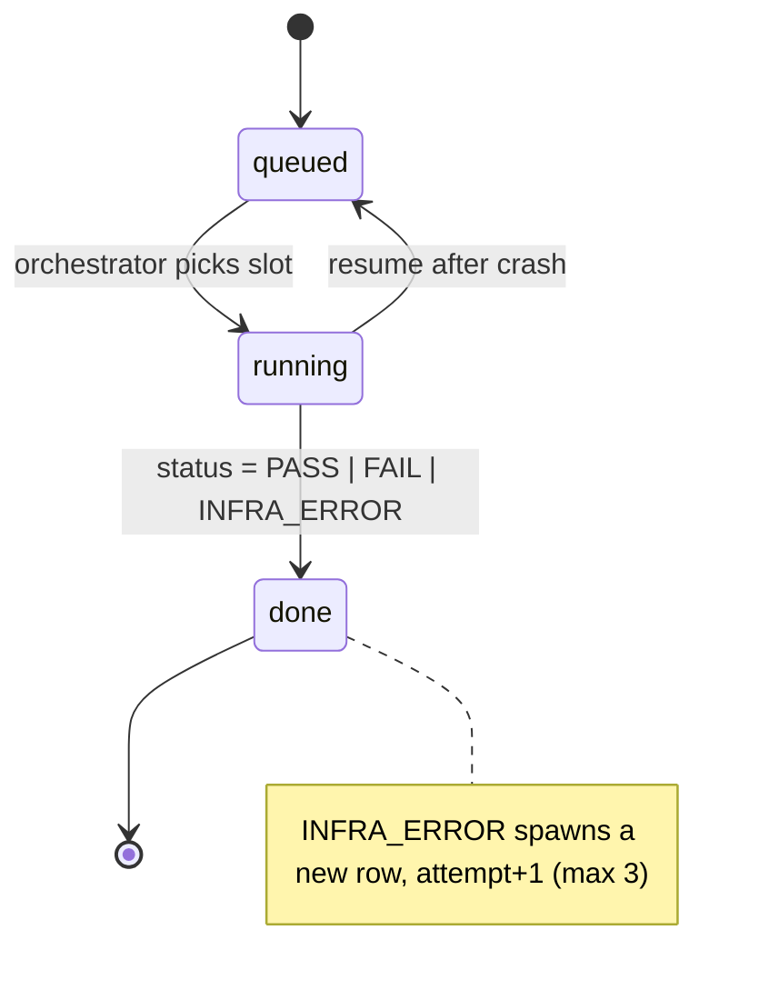

# 06 · Application Flow

> Status: Draft. Screens: [05](05-ux-spec.md). Interfaces: [08](08-api-contracts.md), [10](10-integration-contracts.md).

## 1. Primary journey (agent developer)

1. Open dashboard (`/`) → sees latest benchmark leaderboard (or empty state).
2. `/benchmarks/new` → choose agents, tasks, scenarios, `n_runs`, spend cap → submit.
3. API returns 202; Benchmarks list shows `queued → running` with progress.
4. Orchestrator executes slots; user watches progress (polling).
5. On `completed` open Leaderboard → compare two agents → open Compare grid.
6. Click a cell → run list → click a run → Timeline (what the agent did, where it failed, injected faults).
7. Open Failure scenarios → see same agent under baseline vs faults, resilience score.
8. Read Limitations to understand what the numbers do and do not mean.

```mermaid
sequenceDiagram
  participant U as Dashboard
  participant A as API
  participant D as DB
  participant O as Orchestrator
  participant R as Runner
  participant G as Agent
  participant P as Proxy
  participant B as Bifrost
  participant K as Grader
  U->>A: POST /api/benchmarks
  A->>D: insert benchmark (queued)
  A-->>U: 202 Benchmark
  O->>D: poll queued; expand runs
  loop each slot
    O->>D: run -> running
    O->>R: RunSpec
    R->>G: spawn (env, OPENAI_BASE_URL=proxy/runs/id/v1)
    G->>P: chat/completions
    P->>D: events (llm_call, tool_call, fault_injected)
    P->>B: forward
    B-->>P: response
    P-->>G: response
    G-->>R: exit
    R-->>O: RunResult (diff)
    O->>K: grade
    K-->>O: GradeResult
    O->>D: finalise run (status, tokens, cost...)
  end
  U->>A: GET results / runs / events
  A->>D: query + stats
  A-->>U: JSON
```

## 2. Alternate & failure paths

| # | Situation | Behaviour | Where specified |
|---|---|---|---|
| FP-1 | Launch with invalid config (unknown id, disallowed fault, cap ≤ 0) | 422 with field errors; form stays populated | 08 §3.2 |
| FP-2 | Provider/Bifrost fails for real (not injected) and agent cannot recover | Run `INFRA_ERROR`, retried up to 3 attempts, excluded from stats; UI shows count | F-06 |
| FP-3 | Injected fault (503/429/tool/instruction) | `fault_injected` event; outcome PASS/FAIL per agent behaviour; never INFRA | F-10 |
| FP-4 | Agent times out | `FAIL`, `error='timeout'`, process tree killed | F-03 |
| FP-5 | Agent edits protected test files | Grader `tamper_detected=true` → `FAIL` | F-04 |
| FP-6 | Sandbox/spawn error | `INFRA_ERROR` (retry) | F-03 |
| FP-7 | Orchestrator killed mid-benchmark | On restart, orphaned `running` → `queued`; `done` skipped; benchmark finishes | F-06, AC-05 |
| FP-8 | Spend cap reached | Stop scheduling; in-flight finish; benchmark `halted_spend_cap`; banner in UI | F-06 |
| FP-9 | API unreachable from UI | Error state with Retry; mock ribbon absent | 05 §4 |
| FP-10 | Unknown `run_id` at proxy | 404 OpenAI-shaped error; agent likely misconfigured | 08 §2 |
| FP-11 | Task fails validation | Not loaded; listed in seed loader output; not selectable | F-02 |
| FP-12 | Register broken agent manifest (P1) | 422 with doctor checks; nothing inserted | F-11 |
| FP-13 | Dashboard viewing a running benchmark | Partial results banner with current n | 05 §4 |
| FP-14 | DB write fails in proxy | Request still forwarded; error to stderr; run may under-count → orchestrator marks run `error` note; (events missing are visible via count mismatch) | F-01 |

## 3. Run state machine



Benchmark states: `queued → running → completed | halted_spend_cap | failed` (see 07).
